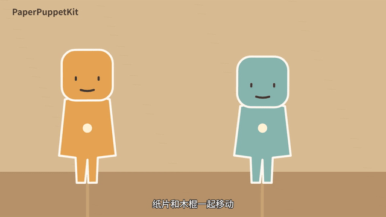

# PaperPuppetKit

**把自己的角色图片变成可以排练、翻面、录制和导出的纸偶动画。**

A local-first Canvas 2D starter for paper puppet animation. Rehearse in the browser, swap expressions edge-on, save motion as JSON, render deterministic frames to MP4.



受到 [ClaudeAnimationBase](https://github.com/JohnHeibel/ClaudeAnimationBase) 的“动画代码 + 角色约定 + 给 AI 的创作指南”组织方式启发。本项目从一支纸偶 MV 的实际制作流程整理而来，采用 Canvas 2D 图片纸偶，不包含 Clawd、p5.js 或 p5.brush 的实现，也不是上游的官方产品。

[在线排练室](https://chimestone.github.io/PaperPuppetKit/studio/index.html) · [在线镜头示例](https://chimestone.github.io/PaperPuppetKit/examples/demo.html) · [下载 Release](https://github.com/chimestone/PaperPuppetKit/releases/tag/v0.1.0)

## 立即试用

需要 **Node.js 22 或更新版本**。浏览器排练无需安装 npm 依赖，不调用模型或云端服务。

```sh
git clone https://github.com/chimestone/PaperPuppetKit.git
cd PaperPuppetKit
npm start
```

打开 http://127.0.0.1:8770 。默认内置两只几何占位纸偶，可直接拖动、播放动作、录制。也可以将仓库静态文件部署到 GitHub Pages；排练室和示例均使用相对路径。

1. 在排练室选中纸偶 A 或 B，选一个表情，点击“替换当前表情图片”。
2. 导入 **512×768** 的透明 PNG，脚底基线 **y=704**。不同表情保持相同人物比例和位置。JPEG/WebP 也可用，但透明素材更适合纸偶。
3. 选背景、调整大小与木棍，点击录制，再拖动或触发动作。
4. 停止后下载 WebM；保存 JSON 工程会同时保存导入图片、背景和动作轨迹。

录制目标 30 fps，实时录制受机器负载影响；保持页面在前台。录制结果无声，MP4 导出可另接本地音频。导入角色每张上限 2 MB，背景 8 MB，工程总大小上限 30 MB。更换素材会清空旧动作，先保存工程。

## 已实现

| 模块 | 用途 |
| --- | --- |
| `studio/` | 双角色排版、拖动、背景导入、图片替换、WebM 录制、JSON 保存与回放 |
| `src/motions.js` | 左右行走、开心、害羞、惊讶、难过、生气；从固定起始姿态计算，避免累计漂移 |
| `src/flips.js` | 先缩到侧边再换图，连续请求排队；木棍保持绑定 |
| `src/stage.js` | 白边、木棍、单线悬挂、背景缩放、合本轻晃、静止展开、右页镜头、脸部标记、旧画面破碎揭示新画面 |
| `src/captions.cjs` | LRC 转 SRT/VTT，支持空白间奏、重复时间标签和 offset |
| `scripts/render.cjs` | 按固定时间采样 Canvas，用 Chrome 与 FFmpeg 导出 MP4，生成渲染报告 |
| `ANIMATION_GUIDE.md` | 人物参考、镜头编排、道具连续性与分幕验收流程，供人或编码 AI 使用 |

## 导出示例 MP4

安装 Chrome/Edge、FFmpeg 后：

```sh
npm ci
npm run render
# 自定义镜头与合法持有的本地音频
node scripts/render.cjs --scene examples/demo.html --out out/my-scene.mp4 --audio /path/to/music.wav
```

默认输出 `out/demo.mp4`，12 秒，1280×720，24 fps。脚本自动检查能否解码。没有音频参数时生成无声视频；音频过短补静音，过长按镜头时长截断。

找不到浏览器或 FFmpeg 时，设置 `CHROME_PATH`、`FFMPEG_PATH`。PowerShell 示例：

```powershell
$env:CHROME_PATH = 'C:/Program Files/Google/Chrome/Application/chrome.exe'
$env:FFMPEG_PATH = 'C:/tools/ffmpeg/bin/ffmpeg.exe'
npm run render
```

本机验收环境为 Windows、Chrome、Node.js 24；提供 macOS/Linux 浏览器路径探测，但本次未在这两个系统实测。

## 字幕

```sh
node scripts/captions.cjs /path/to/your-lyrics.lrc out/lyrics
```

得到 SRT 和 VTT。时间来自输入文件；工具不识别歌词、不自动对齐人声。无后续时间标签的末句默认显示 6 秒。可把 VTT 接到网页 `<track>`，或将 SRT 导入剪辑软件。需要烧录到视频时（FFmpeg 必须含 libass）：

```sh
ffmpeg -i out/demo.mp4 -vf "subtitles=out/lyrics.srt" -c:v libx264 -c:a copy out/subtitled.mp4
```

## 开发与检查

```sh
npm test
npm run test:browser
```

单元检查覆盖翻面切图时机、动作不累计漂移、LRC 间奏处理；浏览器检查覆盖角色图片随工程往返、动作录制、示例转场及静态服务边界。详见 [验证记录](docs/VALIDATION.md)。

镜头接入约定见 [API](docs/API.md)，从 [示例](examples/demo.html) 复制开始。`npm start` 仅监听本机。不存在模型 API 密钥需求；生成角色图片需使用你自己的绘画工具或图像模型。

## 边界与来源

v0.1.0 是双角色排练室和镜头脚手架，不是完整剪辑软件：没有骨骼绑定、自动口型、逐帧动作编辑、分角色叠录或自动音乐情感匹配。保存项目不会自动生成分镜。示例中的纸偶是几何占位图，不代表人物生成质量。

代码与原创几何示例按 MIT 发布。仓库不包含制作时使用的商业歌曲、歌词、外部参考图和 MV 人物素材；用户导入内容的权利不受本仓库许可覆盖。来源说明见 [NOTICE](NOTICE.md)。
